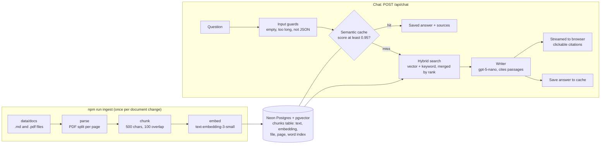

# Doc Bot

A document Q&A bot (RAG) built from scratch in TypeScript. Ask a question in plain English and it answers **only from your documents**, cites the exact passages it used, and says *"I don't know based on the documents."* when they don't cover it.

The sample docs are the help pages of **Nimbus Notes**, a made-up note-taking app (one Markdown handbook + one PDF admin guide).

## What it does

- **Hybrid search:** meaning search (pgvector embeddings) + keyword search (Postgres full-text), merged by rank
- **Answers with citations:** every fact is tagged `[1]`, `[2]`… and the sources panel shows which file, page and chunk each one came from
- **Refuses honestly** when the documents don't contain the answer, with no model call at all when nothing is found
- **Streams** the answer into a Next.js chat UI
- **Semantic cache:** an exact repeat of a question is answered in about a second, skipping search and the model
- **CLI extras:** query rewriting, LLM re-ranking, and a per-stage time/token/cost bill

## Architecture



| Box | File | What it does |
|---|---|---|
| parse | `src/lib/parse.ts` | Markdown as-is; PDFs split into pages so citations can say "page 3" |
| chunk | `src/lib/chunk.ts` | 500-character pieces; each repeats the last 100 characters of the one before, so facts aren't cut in half |
| embed | `src/lib/embed.ts` | turns text into 1536-number "meaning addresses" |
| hybrid search | `src/lib/retrieve.ts`, `src/lib/merge.ts` | runs both searches, merges them by rank (reciprocal rank fusion) |
| writer | `src/lib/answer.ts` | strict prompt: only use the passages, cite `[n]`, refuse if nothing fits |
| cache | `src/lib/cache.ts`, `src/lib/cache-check.ts` | reuses an answer when a new question is almost identical to a saved one |
| chat route | `src/app/api/chat/route.ts` | guards → cache → search → streamed answer |
| UI | `src/app/page.tsx` | chat box, streaming reader, citation buttons, sources panel |

The CLI (`npm run ask`) adds two optional steps between the question and the writer: **rewrite** (turn the question into clean English search queries) and **re-rank** (search keeps 20 candidates, an LLM picks the best 5).

## Tech stack

TypeScript · Next.js 16 · Node.js · PostgreSQL on Neon with pgvector · OpenAI SDK (`gpt-5-nano`, `text-embedding-3-small`) · unpdf

## Quick start

**You need:** Node.js 20 or newer, an [OpenAI API key](https://platform.openai.com/api-keys), and a Postgres database that supports pgvector. A free [Neon](https://neon.tech) project works.

**1. Clone and install**
```bash
git clone https://github.com/aqeell7/doc-bot.git
cd doc-bot
npm install
```

**2. Add your two secrets**
```bash
cp .env.example .env
```
(Windows cmd: `copy .env.example .env`)

Open `.env` and fill in:
- `OPENAI_API_KEY`: your OpenAI key
- `DATABASE_URL`: your Postgres connection string (in Neon: your project → **Connect** → copy the connection string)

Never commit `.env`; it is already in `.gitignore`.

**3. Create the database tables**
```bash
npm run setup-db
```
Expected: `Database ready: ...`. This turns on pgvector and creates the tables from `src/db/schema.sql`. It is safe to run again.

**4. Ingest the documents**
```bash
npm run ingest
```
Expected (with the sample docs): `TOTAL: 21 chunks, ...` (22 on Windows, where line endings add characters) and a cost of a tiny fraction of a cent.

**5. Ask from the terminal**
```bash
npm run ask -- "How long do I have to ask for a refund?"
```
You should see an answer with `[n]` citations, the sources, and a stage-by-stage time/cost bill.

**6. Open the chat UI**
```bash
npm run dev
```
Go to http://localhost:3000 and ask a question. Try *"What is the capital of France?"* to see an honest refusal.

## Use your own documents

1. Put `.md` or `.pdf` files in `data/docs/` (other file types are skipped).
2. Run `npm run ingest`. Each file's old chunks are replaced.
3. Clear old cached answers. In your database's SQL editor run:
   ```sql
   TRUNCATE answer_cache;
   ```
4. If you **removed** a file from `data/docs`, its old chunks are still in the table. To start completely fresh, run `TRUNCATE chunks;` and ingest again.

Note: the query-rewrite prompt (`src/lib/rewrite.ts`, CLI `--rewrite` only) describes the Nimbus Notes handbook. Edit its first lines to describe your documents.

## CLI options

```bash
npm run ask -- "question 1" ["question 2" ...] [options]
```

| Option | What it does |
|---|---|
| `--mode=vector \| keyword \| hybrid` | which search to use (default `hybrid`) |
| `--source=file.pdf` | search only one document |
| `--rewrite` | turn the question into 1–3 clean English search queries first |
| `--rerank` | fetch 20 candidates, let the LLM keep the best 5 |
| `--debug` | print the search lists before and after merging / re-ranking |

With several questions, it also prints the average cost and time per question.

## Project structure

```
data/docs/            sample documents (.md, .pdf)
docs/rag-decisions.md the design write-up: decisions, failures, numbers
NOTES.md              study notes for the whole RAG stack
log.md                before/after test tables from every build session
src/db/schema.sql     every table and index
src/lib/              the bot: parse, chunk, embed, store, retrieve, merge, rerank,
                      rewrite, answer, citations, refusal, cache, meter
src/scripts/          setup-db, ingest, ask (CLI)
src/app/              Next.js UI (page.tsx) and chat API (api/chat/route.ts)
scratch/              practice drills (not part of the bot)
```

## Measured numbers

| | Basic pipeline | With rewrite + re-rank |
|---|---|---|
| Average cost per question | $0.0006 | $0.0015 |
| Cost per 1,000 questions | $0.61 | $1.45 |
| Average time (CLI) | 8.6 s | 21.7 s |

- 95–98% of the model's output tokens are hidden reasoning, so the `reasoning_effort` setting controls most of the cost and the wait. The web writer uses `low` (2–6 s per answer).
- A cache hit answers in about 0.5–1.4 s instead of 4–13 s.
- Why each decision was made, and what failed along the way: [docs/rag-decisions.md](docs/rag-decisions.md).

## Known limitations

- The semantic cache only catches near-exact repeats. Embeddings rate "monthly refund?" and "yearly refund?" as almost identical even though their answers differ, so a looser threshold would serve wrong answers.
- The web route has no re-ranking yet, so a few cross-language questions do worse in the browser than in the CLI.
- Broad questions ("tell me everything about billing") can need more than the 5 passages the writer sees.
- Tested on a small document set (21–22 chunks); one run per question.